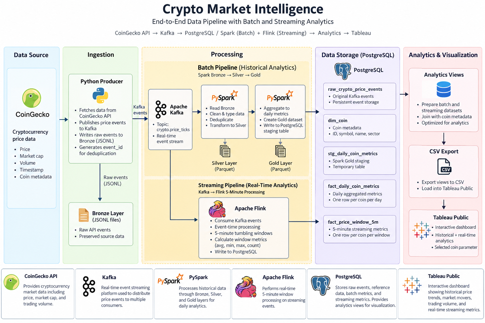

# Crypto Market Intelligence Data Engineering Project

## Overview

I built this project to get hands-on experience designing an end-to-end data engineering pipeline using both batch and streaming processing.

The pipeline collects cryptocurrency price data from the CoinGecko API using a Python producer. Each collection cycle publishes price events to Kafka while also writing the raw events to a local Bronze layer in JSON format.

From there, the project has multiple processing paths:

- A Python Kafka consumer stores event-level data in PostgreSQL.

- PySpark processes the Bronze data through Silver and Gold layers for historical batch analytics.

- Apache Flink independently consumes the Kafka stream and calculates 5-minute price-window metrics for near-real-time analytics.

- PostgreSQL analytics views prepare the final batch and streaming metrics for visualization in Tableau Public.

The main goal of the project was not to use as many technologies as possible, but to understand where each tool fits in a data pipeline and why I would use it.

## Architecture



The project has two main processing paths:

### Batch Pipeline

```text
CoinGecko → Python Producer → Bronze JSONL → PySpark Silver → PySpark Gold → PostgreSQL Staging → SQL Upsert → fact_daily_coin_metrics
```

The batch pipeline stores incoming cryptocurrency events and then processes them with PySpark.

The data moves through a medallion architecture:

- **Bronze:** Raw cryptocurrency API data stored as JSONL
- **Silver:** Cleaned and transformed data
- **Gold:** Aggregated daily cryptocurrency metrics from the Silver layer used for analytics

The Gold data is written to a PostgreSQL staging table before being upserted into the final fact table. This allows the pipeline to update existing records instead of creating duplicate daily metrics every time it runs.

### Streaming Pipeline

```text
CoinGecko → Python Producer → Kafka → Flink → PostgreSQL
```

The streaming pipeline runs separately from the batch pipeline.

Flink continuously consumes cryptocurrency price events from Kafka and calculates metrics over 5-minute windows. The results are written to the `fact_price_window_5m` table in PostgreSQL.

This allowed me to work with both batch processing and continuous stream processing in the same project and understand when each approach is useful.

### Analytics Dashboard
The final analytics layer is visualized using Tableau Public.

PostgreSQL analytics views prepare the batch and streaming datasets before they are exported to CSV and loaded into Tableau Public.

The dashboard separates the project into two analytical perspectives:

# Historical / Batch Analytics

Built from the Spark Gold pipeline:

- Daily Price Trend
- Daily Market Movers
- Daily Trading Volume

# Streaming Analytics

Built from the Kafka and Flink pipeline:

- Latest Average Price
- Window Low
- Window High
- Events in Window
- Streaming Price Trend
- 5-Minute Price Change

A shared Selected Coin parameter allows the user to change the cryptocurrency being analyzed across the historical and streaming visuals.

Tableau Dashboard Link: https://public.tableau.com/app/profile/sam.levin8758/viz/CryptoMarketIntelligenceBatchStreamingDataPipeline/CryptoMarketIntelligence?publish=yes

## Technology Stack

### Python

Used for the CoinGecko producer, Kafka/PostgreSQL ingestion, and supporting pipeline scripts.

### Apache Kafka

Used as the event-streaming layer between the cryptocurrency data source and downstream consumers.

Instead of having every part of the pipeline communicate directly with the CoinGecko API, Kafka provides a central stream of price events that multiple consumers can process independently.

### PostgreSQL

Used to store raw ingested data as well as the final batch and streaming analytics tables.

PostgreSQL also allows the project to use staging tables, fact tables, SQL upserts, and data-quality checks.

### Apache Spark / PySpark

Used for batch transformations.

Spark processes the Bronze data, cleans and transforms it into the Silver layer, and then builds aggregated Gold-level daily cryptocurrency metrics.

### Apache Flink

Used for continuous stream processing.

Flink consumes price events directly from Kafka and calculates 5-minute windowed cryptocurrency metrics without waiting for the batch pipeline to run.

### Docker / Docker Compose

Used to run the different parts of the project in containers, including:

- Kafka
- PostgreSQL
- Spark
- Flink JobManager
- Flink TaskManager

Docker Compose allows the services to communicate with each other while keeping the local environment reproducible.

## Data Model

The PostgreSQL layer contains tables for raw event storage, reference data, batch analytics, and streaming analytics.

### raw_crypto_price_events

Stores the original cryptocurrency price events consumed from Kafka.

This table provides a persistent copy of the incoming event data before downstream transformations.

### fact_price_tick

Stores event-level cryptocurrency price observations in a structured format.

Each event is identified using a deterministic event_id, which allows duplicate events to be ignored during ingestion.

### dim_coin

Stores descriptive information about each cryptocurrency, including:

Coin ID

Symbol

Name

Sector

Active status

This dimension table allows analytical fact tables to be joined with readable cryptocurrency metadata.

### stg_daily_coin_metrics

Temporary staging table used when loading Spark Gold results into PostgreSQL.

Spark writes the daily aggregated dataset into this table first. SQL then upserts the data into the final fact table.

The staging table is intentionally disposable and can be overwritten during each batch load.

### fact_daily_coin_metrics

Final batch analytics table containing one row per cryptocurrency per day.

Metrics include:

Average price

Minimum price

Maximum price

Average market capitalization

Average reported trading volume

Number of price observations

First event timestamp

Last event timestamp

The primary key is based on:

coin_id + metric_date

This prevents multiple final records from being created for the same coin and date.

### fact_price_window_5m

Final streaming analytics table populated by Apache Flink.

Each row represents a 5-minute event-time window for a cryptocurrency.

Metrics include:

Window start

Window end

Average price

Minimum price

Maximum price

Event count

The combination of cryptocurrency and window timestamps uniquely identifies each streaming result.

### Data Quality

I added SQL data-quality checks to validate the reliability of the event-level data before using it for analytics.

The checks are stored in:

sql/data_quality_checks.sql

### Duplicate Event Check

Checks whether the same event_id appears more than once.

Expected result:

0 rows

Duplicate protection also exists earlier in the pipeline:

The producer avoids sending the same event twice during a running session.

The PostgreSQL consumer uses ON CONFLICT DO NOTHING.

Spark Silver performs deduplication using event_id.

This gives the pipeline multiple layers of protection against duplicate events.

### Invalid Price Check

Checks for cryptocurrency events where the price is:

NULL

or:

<= 0

These records would not be valid for price-based analytics.

Expected result:

0 rows

### Data Freshness Check

Checks the newest event timestamp and compares it with the current time.

This answers:

Is the pipeline still receiving current data?

This check caught a real issue during development when the Kafka-to-PostgreSQL consumer had stopped running. The underlying infrastructure was available, but the fact table had become stale.

After restarting and correcting the consumer configuration, PostgreSQL caught up with the Kafka events.

### Recent Coin Coverage

Checks how many expected cryptocurrencies have appeared within the recent ingestion window.

The project currently tracks nine cryptocurrencies, so the expected result during normal operation is:

9 coins

This helps identify situations where the pipeline is technically receiving data but one or more cryptocurrencies are missing.

### Event Volume by Coin

Checks the number of recently received events for each cryptocurrency.

This makes it easier to detect uneven ingestion, missing data, or an individual coin unexpectedly falling behind.

Together, these checks validate:

Uniqueness

Valid prices

Freshness

Coin coverage

Event-volume consistency

The data-quality checks were useful beyond simply validating the final dataset. They also helped identify an actual pipeline problem during development, which showed why monitoring data freshness is important even when the infrastructure itself appears healthy.

## What I Wanted to Learn From This Project

I built this project because I wanted experience with data engineering and thought this would be a really interesting, engaging, and technically challenging project to try.

I chose not to use an existing dataset because I wanted to understand the full data engineering cycle, which is why I decided to start with an API:

```text
API
→ ingestion
→ event streaming
→ raw storage
→ batch processing
→ data modeling
→ streaming processing
→ analytics tables
```

The project gave me hands-on experience with concepts including:

- Batch vs. streaming pipelines
- Kafka producers and consumers
- Bronze, Silver, and Gold medallion architecture
- PySpark transformations
- PostgreSQL staging and fact tables
- Idempotent SQL upserts
- Flink streaming windows
- Data-quality checks
- Containerized data infrastructure with Docker
- Debugging communication between multiple data systems

## Future Improvements

Some possible future improvements include:

- Cloud deployment
- Pipeline orchestration and scheduling
- Additional monitoring and error handling
- Additional real-time metrics
- Automated testing for more parts of the pipeline